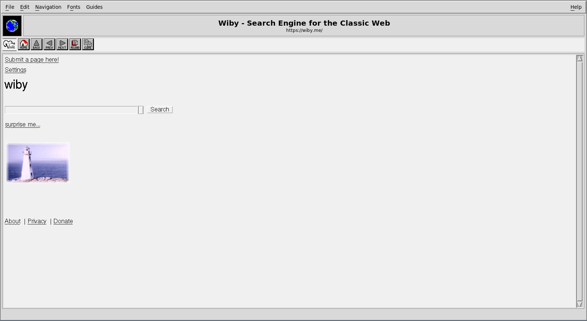

# ViolaWWW Version 4.0 Beta — Linux fork

**October 2025** (upstream) · **Linux fork, October 2026**

> This is a fork of [bolknote/violawww](https://github.com/bolknote/violawww)
> focused on **Linux**. It builds and runs on Debian 13 "trixie" (x86_64,
> GCC 14) and fixes crashes, networking stalls, redraw problems and security
> issues found while bringing it up there. See
> [Changes in this fork](#changes-in-this-fork), and
> [doc/DEBIAN.md](doc/DEBIAN.md) for the full Debian guide. For macOS, use
> [upstream](https://github.com/bolknote/violawww).

---

## Overview

ViolaWWW is an extensible World Wide Web hypermedia browser, originally created by Pei-Yuan Wei in the early 1990s. Based on the Viola scripting language and toolkit, ViolaWWW was one of the first graphical web browsers and pioneered many features that became standard in modern browsers.

### Historical Context

**ViolaWWW (1990-1995)** - Created by Pei-Yuan Wei at UC Berkeley and O'Reilly & Associates
- 1990: Initial Viola toolkit development
- 1992: First ViolaWWW browser release (predated Mosaic)
- 1993-1995: Version 3.x series with HTML 3.0 support, scripting, stylesheets
- Features ahead of its time: embedded scripts, dynamic toolbars, stylesheet mechanism

**ViolaWWW 4.0 (2025)** - Modern enhancements by Evgeny Stepanischev
- Ported to 64-bit architectures (from original 32-bit)
- HTTPS/TLS support via OpenSSL
- HTTP redirect handling (301, 302, 303, 307, 308)
- Internet Archive (Wayback Machine) integration
- Proto-VRML graphics tags implementation (GRAPHICS, ROT, SCALE, etc.)
- HTML+ CHANGED tag for document revision tracking (yellow background highlighting)
- Multi-encoding support with transliteration (Windows-1251, KOI8-R, UTF-8 → Latin/ASCII)
- Socket timeouts and improved error handling
- Modern build system with parallel compilation
- **STG Stylesheet System** - Implementation of Pei-Yuan Wei's 1993 stylesheet language predating CSS, featuring hierarchical context-sensitive styling, tag-based selectors, minor selectors, and visited link coloring via `traversedForegroundColor`
- **FIGURE Element Support** - Full implementation with FIGDATA for inline images (XBM, XPM, GIF, PostScript), FIGA client-side image maps with clickable hotspots, FIGCAP captions, and delayed loading capabilities
- **Mathematical Notation** - Native rendering of `<MATH>` expressions with subscripts/superscripts, fractions, extensible parentheses/brackets, and mathematical symbols (&pi;, &sigma;, &integral;, &infin;)
- Bug fixes including buffer overflow issues and other security improvements

This version brings ViolaWWW into the modern web era while preserving its unique extensible architecture and historical significance.

---

## Changes in this fork

All changes are separate, documented commits on top of upstream, so they can
be reviewed or sent upstream individually.

**Building on Linux**
- Builds with GCC 14 on Debian 13 (missing headers, type fixes in the HTML DTD tables)
- `make san` (AddressSanitizer + UndefinedBehaviorSanitizer) works with GCC
- Test suite (`make test`) builds and passes on Linux
- Compiler warnings cut to the meaningful ones; bugs they pointed to fixed

**Crashes and memory**
- HTML build-stack underflow ("stacki out of bounds") and buffer overrun in the page builder
- Double `fclose` when loading pages; use-after-free when retrying an HTTPS connection
- Crash on redirect loops (now stops at the loop)
- Per-page memory leaks found with LeakSanitizer
- `tmpnam()` replaced with `mkstemps()` for temporary files

**Networking**
- 60-second stall on every HTTPS page, and garbage at the top of pages on
  kept-alive connections (body length was counted from the wrong place)
- Well-formed `Accept` and `User-Agent` headers
- Web Archive fallback now asks the Archive for its newest copy directly
  (about 1 s instead of a ~20 s CDX search)
- More useful HTTPS tracing under `-verbose`

**Display and interface**
- Pages left blank or half drawn until the mouse moved: Viola's redraw
  events were being discarded or left waiting; the window now also repaints
  while a page loads
- Light theme, anti-aliased (Xft) fonts for menus, buttons and dialogs, larger
  default page text
- New **Edit** menu with Copy (Ctrl-C) and Paste (Ctrl-V) through the X
  clipboard; Clone moved to Ctrl-N; Ctrl-C/X/V work in dialog text fields

**Security**
- `mailto:` and `telnet:` links are opened with `xdg-open` / a terminal
  without going through a shell (they used to be passed to `sh`, so a page
  could run commands through a crafted link)

---

## Key Features

### Original ViolaWWW Features (v3.3)

* **HTML 3.0 Support** - Container-based document model with extensions for:
  - Multiple column formatting
  - Client-side document insertion
  - Dynamically collapsable/expandable lists

* **Sidebar Panel** - Display meta information and navigational links

* **Dynamic Toolbar** - Document-engaged tool applets

* **Stylesheet Mechanism** - Attach styling to documents (fonts, colors, alignments)

* **Scripting Language** - Embed highly interactive scripts/applets in HTML

* **Motif Front-end** - Plus X11-only version for systems without Motif

* **Hotlist Facility** - With HTTP loading progress visualization

* **Experimental Platform** - Source available, highly customizable

### Modern Enhancements (v4.0 - 2025)

#### 64-bit Architecture Port
- Full compatibility with modern 64-bit systems
- Fixed pointer size issues (32-bit → 64-bit)
- Updated integer types for proper memory addressing
- Tested on Debian 13 "trixie" (x86_64, GCC 14)
- Maintained backward compatibility with build system

#### Interface Restoration
- Restored original browser appearance from author's drafts and code comments
- Removed non-functional UI elements and placeholder buttons
- Fixed window dimensions and layout to match intended design
- Enabled previously commented-out working features
- Result: Clean interface matching the original vision for ViolaWWW 3.x

#### HTTPS/TLS Support
- Native SSL/TLS via OpenSSL 3.x
- TLS 1.0+ with SNI (Server Name Indication)
- Automatic protocol detection for `https://` URLs
- Secure connections to modern websites
- **Files**: `HTSSL.h`, `HTSSL.c`, `HTTPS.h`, `HTTPS.c`

#### HTTP Keep-Alive Connection Manager
- Connection pooling and reuse for improved performance
- Automatic keep-alive detection via HTTP headers
- Connection pool (max 6 concurrent connections)
- Configurable timeout (default 30 seconds)
- Automatic cleanup of stale connections
- Reduces latency for multiple requests to same host
- **Files**: `HTKeepAlive.h`, `HTKeepAlive.c`

#### STG Stylesheet System

ViolaWWW 4.0 implements the STG (Style Tag Group) stylesheet system, designed by Pei-Yuan Wei in 1993 and predating CSS. This hierarchical stylesheet language provides context-sensitive styling with unique capabilities not found in modern CSS, though with some limitations compared to the original vision.

**Key Features:**
- **Hierarchical Selectors**: Lisp-like syntax with nested parentheses for context-dependent styles
- **Tag-Based Styling**: Apply styles to HTML elements by tag name with comma-separated multiple selectors
- **Attribute-Based Variants**: Use `{STYLE "value"}` minor selectors for style variations (equivalent to CSS classes)
- **Context Sensitivity**: Nested selectors only apply within specific parent elements
- **Visited Link Styling**: `traversedForegroundColor` attribute for styling visited links (equivalent to CSS `:visited`)
- **Color Support**: Full X11 color database with basic colors, extended colors, and grey scales (grey0-grey100)
- **Typography**: Font size scaling (smallest→largest), slant (normal/italic/bold), and spacing (proportional/mono)
- **Layout**: Text alignment, borders with custom colors, and blinking text effects

**Example STG Stylesheet:**
```
(BODY
    FGColor=black
    BGColor=white

    (H1
        fontSlant=bold
        FGColor=darkblue
        align=center
    )

    (A
        FGColor=blue
        traversedForegroundColor=purple
    )

    (P
        {STYLE "WARNING"
            FGColor=red
            border=2
            BDColor=orange
        }
    )
)
```

**HTML Usage:**
```html
<link rel="style" href="stylesheet.stg">
<p style="WARNING">This paragraph has red text and orange border</p>
```

**Technical Details:**
- **Files**: `src/libStyle/libstg.c`, `src/libStyle/libstg.h`, `src/viola/stgcall.c`
- **Context Matching**: Hierarchical matching algorithm builds ancestor chain for style resolution
- **Memory Management**: Efficient ID-based lookups with automatic memory cleanup
- **Limitations**: Some attributes like `numStyle`, `compact`, `space` are parsed but not implemented; STG was designed with only `STYLE` attribute support for minor selectors (no CLASS/ID concepts like in CSS)

**Historical Context**: STG was proposed on WWW-Talk mailing list in October 1993, representing one of the earliest attempts to separate presentation from content on the web.

#### FIGURE Element Implementation

The FIGURE element provides advanced image embedding capabilities with client-side image maps, inline image data, and captions - features that were later adopted by modern HTML standards.

**Supported Image Formats:**
- **XBM (X BitMap)**: Monochrome bitmap format, embeddable inline via FIGDATA
- **XPM (X PixMap)**: Color pixmap format, embeddable inline via FIGDATA
- **GIF**: Binary format with Base64 encoding for inline embedding
- **PostScript**: Vector graphics converted to GIF via ImageMagick

**Key Features:**
- **FIGDATA**: Inline image data embedding without external file references
- **FIGA Hotspots**: Client-side image maps with rectangular regions and URL links
- **FIGCAP**: Image captions with automatic text wrapping
- **ISMAP**: Server-side image maps for coordinate-based interactions
- **Dimensions**: WIDTH/HEIGHT attributes with MAXWIDTH/MINWIDTH constraints
- **Delayed Loading**: MAYDELAY attribute for progressive image loading

**Example Usage:**
```html
<FIGURE TYPE="xbm" SRC="worldmap.xbm">
  <FIGA HREF="/americas" AREA="0 0 16 32"></FIGA>
  <FIGA HREF="/europe" AREA="16 0 16 32"></FIGA>
  <FIGCAP>World Map - Click regions for details</FIGCAP>
</FIGURE>

<FIGURE TYPE="gif">
<FIGDATA>
R0lGODlhIAAgAIAAAAAAAP///yH5BAAAAAAALAAAAAAgACAAAAJBhI+py+0P
</FIGDATA>
  <FIGA HREF="/left" AREA="0 0 16 32"></FIGA>
  <FIGA HREF="/right" AREA="16 0 16 32"></FIGA>
</FIGURE>
```

**Technical Implementation:**
- **Inline Processing**: FIGDATA content parsed and converted to temporary files
- **Hotspot Interaction**: Hover highlighting and click navigation
- **Format Conversion**: PostScript images automatically converted to GIF
- **Base64 Decoding**: Built-in decoder for GIF inline embedding
- **Files**: Multiple Viola scripts for each format and feature combination

#### Mathematical Expression Rendering

ViolaWWW 4.0 includes native mathematical notation rendering, transforming HTML `<MATH>` elements into properly formatted mathematical expressions with vector graphics and scalable symbols.

**Mathematical Elements:**
- **`<MATH>...</MATH>`**: Container for mathematical expressions
- **`<sup>...</sup>`**: Superscript (exponents) with 70% scaling
- **`<sub>...</sub>`**: Subscript (indices) with 70% scaling
- **`<box>...<over>...</box>`**: Vertical fractions with division lines
- **Parentheses `()` and Brackets `[]`**: Extensible delimiters that scale to content height

**Mathematical Symbols:**
- **`&integral;`**: Integration symbol (∫) with limits support
- **`&sigma;`**: Summation symbol (Σ) with range notation
- **`&infin;`**: Infinity symbol (∞) with scaling
- **`&pi;`**: Pi symbol (π) with proper Greek letter rendering

**Advanced Features:**
- **Nested Expressions**: Complex hierarchies with proper layout
- **Vector Graphics**: Symbols drawn using X11 primitives for crisp rendering
- **Automatic Scaling**: Smaller symbols in superscript/subscript contexts
- **Extensible Delimiters**: Parentheses and brackets stretch to match content height
- **Complex Examples**: Euler's identity, quadratic formula, Taylor series

**Example Expressions:**
```html
<math>E = mc<sup>2</sup></math>
<math><box>a<over>b</box> + <box>c<over>d</box></math>
<math>&integral;<sup>b</sup><sub>a</sub> f(x) dx</math>
<math>e<sup>i&pi;</sup> + 1 = 0</math>
<math>(<box>x<sup>2</sup> + y<over>z</over></box>)</math>
```

**Technical Implementation:**
- **MAST Engine**: Mathematical Abstract Syntax Tree with three-phase layout algorithm
- **Token System**: 22 internal tokens for different mathematical constructs
- **Rendering Pipeline**: Tiling, expandable element processing, and centering
- **Files**: `src/viola/htmath.c`, `src/viola/htmath.h`, multiple Viola scripts
- **Documentation**: [MATH_REFERENCE.md](doc/MATH_REFERENCE.md)

#### HTTP Redirect Handling
- Automatic following of redirects: 301, 302, 303, 307, 308
- Cross-protocol redirects (HTTP ↔ HTTPS)
- Loop prevention (max 10 hops)
- Relative URL resolution
- **Files**: `HTTP.c`, `HTTPS.c`

#### Internet Archive Integration
- Automatic fallback to Wayback Machine for unavailable domains
- DNS failure detection triggers archive search
- Newest capture via the Wayback Machine's own redirect (this fork; upstream used the CDX API)
- Transparent loading of archived sites with proper base URL handling
- **Files**: `HTWayback.h`, `HTWayback.c`
- **Tests**: `test/test_wayback.c`, `test/test_wayback_detection.c`

#### Multi-Encoding Transliteration Support
- Automatic character encoding detection from HTTP headers (`x-archive-guessed-charset`, `Content-Type`)
- Support for multiple encodings: UTF-8, Windows-1251, KOI8-R, ISO-8859-1, and more
- Three-pass conversion pipeline:
  1. Source encoding → UTF-8 (via iconv with //IGNORE for mixed bytes)
  2. Any-Latin transliteration (Cyrillic, Greek, Chinese → Latin via ICU)
  3. UTF-8 → ISO-8859-1//TRANSLIT for ASCII compatibility
- Converts Cyrillic → Latin (Привет → Privet, яфй → âfj)
- Converts special characters (• → *, → → ->, — → -)
- Preserves Latin diacritics (ö, ß, Ł, ó, ź, ś)
- **Files**: `HTCharset.h`, `HTCharset.c`, `HTAnchor.h`, `HTAnchor.c`, `HTMIME.c`, `SGML.c`
- **Test**: `test/test_htcharset.c` (German, Polish, Russian, Windows-1251, KOI8-R)

#### NNTP News Protocol Improvements
- **New URL schemes**: `nntp://host/group` and `news://host/group` for direct server access
- No need to set `NNTPSERVER` environment variable when using URL with host
- Article access by number: `nntp://host/group/article-number`
- RFC 2047 MIME encoded-word decoding in article headers (Subject, From, etc.)
- Transliteration of non-ASCII characters in newsgroup listings and articles
- Example: `=?UTF-8?Q?J=C3=B6rg?=` → "Jörg" (Latin diacritics preserved in ISO-8859-1)
- Supports both Quoted-Printable (`?Q?`) and Base64 (`?B?`) encodings
- Fixed EOF handling for `-funsigned-char` compiler flag
- Proper connection cleanup after each request (prevents hangs)
- **Files**: `HTNews.c`, `HTCharset.c`
- **Documentation**: [PROTOCOLS_REFERENCE.md](doc/PROTOCOLS_REFERENCE.md)

#### Mathematical Expression Rendering
- Native rendering of mathematical HTML entities and expressions
- Supported entities: `&pi;` (π), `&sigma;` (Σ), `&infin;` (∞), `&integral;` (∫)
- Subscripts and superscripts with proper scaling and positioning
- Fraction rendering with horizontal division lines
- Parentheses and brackets that scale to content height
- Complex nested expressions with proper layout and alignment
- Vector graphics rendering for integral symbol using X11 drawing primitives
- Automatic scaling of symbols in superscript/subscript contexts
- **Files**: `htmath.h`, `htmath.c`, `embeds/HTML_math_script.v`
- **HTML Tag**: `<MATH>` element support
- **Documentation**: [MATH_REFERENCE.md](doc/MATH_REFERENCE.md)

#### HTML+ CHANGED Tag (Document Revision Tracking)
- Implementation of HTML+ (1993) `<CHANGED>` element for marking document revisions
- Paired marker syntax: `<changed id=X>text<changed idref=X>` (not a container tag)
- Visual highlighting with LemonChiffon1 (pale yellow) background
- Spans across structural boundaries (paragraphs, lists, headers)
- Preserves original text color (compatible with stylesheets)
- **Files**: `html2.c`, `sgml.c`, `tfed.c`, `glib_x.c`
- **Documentation**: [CHANGED_TAG_REFERENCE.md](doc/CHANGED_TAG_REFERENCE.md)

#### Proto-VRML Graphics Tags (Full Implementation)
- Implementation of Pei-Yuan Wei's 1994 experimental 3D graphics proposal
- Container: `<GRAPHICS>` with WIDTH, HEIGHT attributes
- Primitives: `<RECT>`, `<SQUARE>`, `<CIRCLE>`, `<OVAL>`, `<LINE>`, `<POLYGON>`, `<POINT>`, `<TEXT>`
- Text rendering: `<TEXT LABEL="...">` with XRender-based rotation and scaling
- Positioning and sizing: `<POS>`, `<SIZE>` with X, Y, Z coordinates
- 3D transformations with perspective projection:
  - `<ROT X=... Y=... Z=...>` — rotation around all three axes
  - `<SCALE X=... Y=... Z=...>` — scaling with perspective
  - `<AXIS>` — transformation center point
- Colors: `<FGCOLOR>`, `<BGCOLOR>`, `<BDCOLOR>` with named colors
- Interactive elements: `<BUTTON>` with LABEL, HREF, HINT attributes (3D appearance, click handling, status bar hints)
- Interactive scripting: `<ACTION>` with inline `<SCRIPT TYPE="viola">` for all shapes
- Multi-user sync: `SC` attribute for real-time property synchronization via UDP broadcast
- **Files**: `embeds/HTML_graphics_script.v`, `HTML_button_script.v`, `HTML_rect_script.v`, `HTML_polygon_script.v`, etc.
- **Documentation**: [GRAPHICS_TAGS_REFERENCE.md](doc/GRAPHICS_TAGS_REFERENCE.md)

#### TTY Interface Restoration
- Restored inter-process communication via TTY class
- Run external programs and capture their output
- Bidirectional communication with child processes
- Configurable delimiters for output parsing
- **Documentation**: [TTY_REFERENCE.md](doc/TTY_REFERENCE.md)

#### VPLOT 3D Surface Plotter
- Interactive 3D surface and wireframe model viewer
- Mathematical expression parser (sin, cos, exp, sqrt, abs, etc.)
- Real-time rotation via sliders or mouse drag
- Support for OFF file format (3D models)
- HiDPI display support
- **Files**: `examples/plot.v`, `examples/vplot.v`
- **Documentation**: [VPLOT_REFERENCE.md](doc/VPLOT_REFERENCE.md)

#### Infrastructure Improvements
- 64-bit architecture support (from 32-bit original)
- Socket timeouts (30s for HTTP/HTTPS, 5s for Wayback API)
- Parallel compilation support (`make -j`)
- Comprehensive test suite (`make test`)
- Enhanced error handling and logging
- Buffer overflow protection (increased URL buffer sizes)
- Memory safety improvements for modern systems

---

## Screenshots

### ViolaWWW Motif Frontend (vw)

*Modern web browsing with the classic Motif interface, on Debian 13*




---


## Quick Start

For a step-by-step guide, including troubleshooting, see **[doc/DEBIAN.md](doc/DEBIAN.md)**.

### Requirements (Debian / Ubuntu)

#### Required

```bash
sudo apt install build-essential pkg-config byacc bsdextrautils \
    libmotif-dev libx11-dev libxext-dev libxt-dev libxmu-dev \
    libsm-dev libice-dev libxrender-dev \
    xfonts-75dpi xfonts-100dpi
```

- **libmotif-dev**: Motif toolkit for the `vw` browser (without it only the plain X11 `viola` is built)
- **byacc**: Berkeley Yacc, for the Viola script grammar
- **bsdextrautils**: provides `hexdump`, used to embed the Viola scripts at build time
- **xfonts-75dpi / xfonts-100dpi**: the bitmap Helvetica/Times fonts used for page text

#### Recommended (build time)

```bash
sudo apt install libssl-dev libicu-dev
```

- **libssl-dev**: HTTPS support
- **libicu-dev**: UTF-8 and other character sets transliterated for display

#### Optional (run time)

| Program | Debian package | Purpose |
|---------|----------------|---------|
| **xdg-open** | `xdg-utils` | `mailto:` links open your mail program |
| **telnet** + a terminal | `inetutils-telnet`, `xterm` | `telnet://host` links |
| **Ghostscript** | `ghostscript` | PostScript display and conversion |
| **ImageMagick** | `imagemagick` | PostScript-to-GIF conversion |
| **OpenSP** | `opensp` | HMML document parsing (`onsgmls`) |
| **x3270** | `x3270` | `tn3270://host` links (IBM mainframe) |

### Building

```bash
# Clone this fork
git clone https://github.com/dleecurt/violawww.git
cd violawww

# Compile (parallel build)
make clean
make -j"$(nproc)"

# Run tests
make test
```

Two binaries will be generated:
- `src/viola/viola` - Pure XLib version (smaller, no Motif required)
- `src/vw/vw` - Motif version (polished GUI)

Debugging builds:

```bash
make san        # AddressSanitizer + UndefinedBehaviorSanitizer
ASAN_OPTIONS=detect_leaks=0 ./src/vw/vw    # silence the leak report at exit
./src/vw/vw -verbose 2>&1 | tee vw.log     # protocol and event tracing
```

### Running

```bash
# Start with a URL
./src/vw/vw https://example.com

# Or use environment variable
export WWW_HOME=https://info.cern.ch
./src/vw/vw

# Pure X11 version
./src/viola/viola https://example.com
```

### X Resources

Add to `~/.Xdefaults` for better appearance:

```xdefaults
Viola.x:                550
Viola.y:                10
Viola.width:            620
Viola.height:           700
Viola*foreground:       black
Viola*background:       grey80
Viola.foreground_doc:   black
Viola.background_doc:   grey90
```

Then reload: `xrdb -load ~/.Xdefaults`

The Motif parts of the window (menus, buttons, dialogs, title) use Xft
fonts, set with render-table resources, for example:

```xdefaults
Viola*uiFont.fontSize:      11
Viola*titleFont.fontSize:   16
Viola*monoFont.fontName:    DejaVu Sans Mono
```

Page text size can be changed from the **Fonts** menu.

---

## Web Archive Integration

### Automatic Fallback

When a page can't be loaded (DNS failure, connection error, or an error
status such as 403/404), ViolaWWW automatically:
1. Requests `https://web.archive.org/web/<now>id_/<url>`
2. Lets the Archive redirect to its **newest capture** (or answer 404 if it has none)
3. Loads the archived version transparently

### Example Usage

```bash
# Try a defunct site - will automatically load from archive
./src/vw/vw http://www.hackzone.ru/

# Browser will detect the failure and load the newest capture, e.g.:
# https://web.archive.org/web/<timestamp>id_/http://www.hackzone.ru/
```

### Technical Details

- **No search request**: the Wayback Machine resolves a request for the
  current time to its closest (newest) capture itself; this replaced the CDX
  search, which often took 20 seconds or more
- **`id_` mode**: pages are fetched as originally served, without the Archive toolbar
- **Redirect loops** between captures are detected and stopped
- **Base URL**: Automatically updates for proper relative link resolution
- **Smart Detection**: Prevents infinite loops by detecting Web Archive URLs and skipping fallback

### Web Archive URL Detection

The system intelligently detects when a URL is already from the Web Archive to prevent infinite loops:

- ✅ Detects `https://web.archive.org/web/TIMESTAMP/URL` patterns
- ✅ Handles both HTTP and HTTPS Web Archive URLs
- ✅ Supports subdomains (e.g., `subdomain.web.archive.org`)
- ✅ Skips Wayback fallback for already-archived URLs
- ✅ Prevents recursive archive queries

---

## HTTPS Support

### Features

- ✅ TLS 1.0+ support (OpenSSL 3.x)
- ✅ SNI (Server Name Indication)
- ✅ Automatic redirect following (HTTP→HTTPS)
- ✅ Standard port 443
- ⚠️ Certificate verification disabled (for compatibility)

### Security Notes

**WARNING**: For compatibility with old/self-signed certificates, SSL certificate verification is set to `SSL_VERIFY_NONE`. This is suitable for testing and browsing trusted sites but makes connections susceptible to MITM attacks.

### Testing HTTPS

```bash
# Simple test
./src/vw/vw https://example.com

# Historic site with HTTPS
./src/vw/vw https://info.cern.ch

# With verbose logging
./src/vw/vw -v https://example.com
```

---

## HTTP/HTTPS Keep-Alive Connection Pool

### Overview

ViolaWWW 4.0 implements persistent HTTP/HTTPS connections (keep-alive) with a connection pool, significantly improving page load performance by reusing TCP/SSL connections.

### Features

- ✅ **Connection Pool**: Up to 6 concurrent persistent connections
- ✅ **Automatic Connection Reuse**: Transparent reuse for same-host requests
- ✅ **Smart Redirect Handling**: Reuses connections for same-host redirects
- ✅ **Stale Connection Detection**: Automatic detection and cleanup of broken connections
- ✅ **HTTP/1.1 Support**: Full chunked transfer encoding support
- ✅ **Content-Length Handling**: Efficient reading without waiting for EOF
- ✅ **Statistics Tracking**: Per-connection metrics (reuses, bytes, age)

### Performance Improvements

**Without Keep-Alive:**
- Each request = new TCP + SSL handshake
- HTTPS handshake: ~500-1500 ms per resource
- Page with 10 images ≈ 30-40 round trips

**With Keep-Alive:**
- Connection reuse across multiple requests
- HTTPS handshake: only once per host
- Page with 10 images ≈ 13-15 round trips
- **Speed improvement: 18-80× faster** 🚀

### Technical Details

**Connection Pool Management:**
- Maximum 6 simultaneous connections (HTTP/1.1 spec)
- Idle timeout: 30 seconds
- Automatic cleanup of expired/broken connections
- Thread-safe design (single-threaded for now)

**Protocol Compliance:**
- HTTP/1.0: Keep-Alive with Content-Length
- HTTP/1.1: Keep-Alive with chunked encoding
- Graceful fallback for non-supporting servers

**Socket Timeouts:**
- Connect: 30 seconds
- Read (with Content-Length): 60 seconds
- Read (chunked): 10 seconds between chunks
- Read (no length): 60 seconds until EOF

### Debug Mode

Enable verbose logging to see connection statistics:

```bash
./src/vw/vw -v https://example.com
```

Output will show:
```
HTKeepAlive: Reusing HTTPS connection to example.com:443 (reuse #3)
HTTPS: Downloaded 8796 bytes in 1066 ms (8.1 KB/s, connect: 0 ms)
HTKeepAlive: Stored HTTPS connection (reuses=3, requests=4, bytes=25680)
```

### Architecture

**New Files:**
- `src/libWWW/Library/Implementation/HTKeepAlive.h` - Connection pool API
- `src/libWWW/Library/Implementation/HTKeepAlive.c` - Pool implementation

**Modified Files:**
- `src/libWWW/Library/Implementation/HTTPS.c` - HTTPS with keep-alive
- `src/libWWW/Library/Implementation/HTTP.c` - HTTP with keep-alive
- `src/viola/viola.c` - Pool initialization

### Limitations

1. Maximum 6 connections per pool
2. 30-second idle timeout
3. Some servers (e.g., web.archive.org) inconsistently support keep-alive

---

## Testing

### Run All Tests

```bash
make test
```

### Individual Tests

```bash
# Character set conversion
./test/test_htcharset

# Web Archive integration
./test/test_wayback

# Web Archive URL detection
./test/test_wayback_detection

# HTTPS functionality (manual)
./src/vw/vw test_https.html
```

---

## Architecture

### Directory Structure

```
violawww2/
├── src/
│   ├── libWWW/Library/Implementation/  # WWW protocol library
│   │   ├── HTTP.c, HTTPS.c             # HTTP/HTTPS clients
│   │   ├── HTSSL.c                     # SSL/TLS wrapper
│   │   ├── HTKeepAlive.c               # Connection manager
│   │   ├── HTWayback.c                 # Archive integration
│   │   ├── HTCharset.c                 # Character encoding
│   │   └── HTAccess.c                  # Access manager
│   ├── libIMG/                         # Image handling (GIF, XBM, XPM, etc)
│   ├── libStyle/                       # Stylesheet processing
│   ├── libXPA/                         # X Pixmap Applets
│   ├── libXPM/                         # X Pixmap library
│   ├── viola/                          # Viola toolkit & core browser
│   └── vw/                             # ViolaWWW Motif frontend
├── test/                               # Unit tests
├── Makefile                            # Main build file
└── README.md                           # This file
```

### Protocol Flow

```
User Request (https://example.com)
  ↓
HTAccess.c (protocol dispatcher)
  ↓
HTTPS.c (HTTPS protocol handler)
  ↓
HTKeepAlive.c (connection manager)
  ├─ Check for existing connection
  ├─ Reuse if available & valid
  └─ Create new if needed
  ↓
socket() + connect() (TCP)
  ↓
HTSSL_connect() (TLS handshake)
  ↓
HTSSL_write() (HTTP request over TLS)
  ↓
HTSSL_read() (HTTP response over TLS)
  ↓
Connection returned to pool (keep-alive)
or closed (Connection: close)
  ↓
Parse & Render
```

---

## HMML Support (Legacy Format)

ViolaWWW originally supported **HMML** (HyperMedia Markup Language) — Pei-Yuan Wei's experimental markup language that predated/paralleled HTML in the early 1990s.

### What is HMML?

HMML was ViolaWWW's native document format with elements like:
- `HMML` (root), `BODY`, `SECTION`, `TITLE`
- `H1-H3` headers, `P` paragraphs
- `PIC`, `XBM`, `XPM` for images
- `VOBJF` for embedded Viola objects
- `LISTING`, `EXAMPLE`, `QUOTE`

### File Extensions

- `.hmml` — text HMML documents (require SGML parsing)
- `.hmmlb` — binary HMML (pre-parsed)

### Requirements

HMML support requires the **OpenSP** SGML parser:

```bash
sudo apt install opensp
```

The `onsgmls` utility from OpenSP is used to parse HMML documents. `src/viola/sgmlsA2B.c` looks for it next to the executable and then in the standard locations, including `/usr/bin` (where Debian installs it) and `/usr/local/bin`.

### Note

HMML is essentially a historical curiosity. Modern web content uses HTML, which ViolaWWW parses natively without external dependencies.

---

## Known Limitations

1. **SSL/TLS**: Certificate verification disabled by default
2. **HTTP/2**: Not supported (HTTP/1.0 only)
3. **JavaScript**: Limited scripting (Viola script only)
4. **CSS**: Basic stylesheet support only
5. **Modern HTML**: HTML 3.0 era support
6. **Redirects**: No UI for redirect chains
7. **Blocked sites**: Wikipedia and some other sites refuse ViolaWWW (HTTP 403, bot policy); the archive fallback is used instead
8. **Modern sites**: most pages built with JavaScript render empty or partially; text-oriented sites (text.npr.org, lite.cnn.com, wiby.me, sdf.org) work well
9. **Page loading** blocks input: menus and title repaint, but clicks wait until the page is loaded

---

## Development

### Building from Source

```bash
# Clean build
make clean
make -j$(nproc)

# Debug build
make clean
CFLAGS="-g -O0" make

# Without OpenSSL
make clean
make NO_SSL=1
```

### Code Analysis Tools

New Makefile targets for analyzing unused includes and libraries:

```bash
# Show all analysis commands
make check-help

# Quick analysis (no extra tools needed)
make check-includes-manual   # Show include hierarchy
make check-libs              # Show linked libraries
make check-symbols           # Show used symbols from libraries
make check-unused            # Build with unused code warnings

# Advanced analysis (requires include-what-you-use)
sudo apt install iwyu
make check-includes          # Analyze glib_x.c
make check-includes-all      # Analyze all sources
```

### Code Style

The codebase maintains the original ViolaWWW style:
- K&R-style C
- 4-space indentation (tabs in some areas)
- ANSI C with some C99 features
- Original libwww conventions

### Contributing

Contributions are welcome! Areas of interest:
- Modern protocol support
- Security improvements
- Character encoding
- Test coverage
- Documentation

---

## Acknowledgements

### Original ViolaWWW (1990-1995)

**Author**: Pei-Yuan Wei (wei@ora.com)  
**Organization**: O'Reilly & Associates, Inc.

**Special Thanks**:
- Tim Berners-Lee - WWW invention
- CERN team - libwww library
- Jon Blow (ORA) - Lexical analyzer
- Scott Silvey (ORA) - Motif front-end
- Terry Allen (ORA) - SGML testing
- Dale Dougherty & Tim O'Reilly - Supporting Viola at ORA
- Beta testers community

### Modern Enhancements (2025)

**Developer**: Evgeny Stepanischev (imbolk@gmail.com)

**Contributions**:
- Ported to 64-bit ARM64 architecture (Apple Silicon)
- STG stylesheet system implementation (hierarchical context-sensitive styling predating CSS)
- FIGURE element support (inline images, client-side image maps, captions, multiple formats)
- Mathematical notation rendering (`<MATH>` expressions with subscripts/superscripts, fractions, symbols)
- HTTPS/TLS support with OpenSSL integration
- HTTP redirect handling (3xx status codes)
- Internet Archive (Wayback Machine) integration
- Multi-encoding support with transliteration (Windows-1251, KOI8-R, UTF-8 → Latin/ASCII via iconv + ICU)
- Character encoding detection from HTTP headers (x-archive-guessed-charset, Content-Type)
- NNTP news protocol improvements (`nntp://` and `news://` URL schemes, MIME encoded-word decoding, transliteration)
- Proto-VRML graphics tags implementation (GRAPHICS, RECT, CIRCLE, POLYGON, ROT, SCALE, SC sync, etc.)
- HTML+ CHANGED tag implementation (document revision highlighting with LemonChiffon1 background)
- TTY interface restoration for external process communication
- VPLOT 3D surface plotter implementation
- macOS app bundle with native launcher and DMG distribution
- Socket timeouts and error handling
- Modern build system improvements
- Comprehensive test suite
- Buffer overflow and memory safety fixes
- Documentation updates

---

## License

ViolaWWW is provided as-is for educational and research purposes. The original source was made available by O'Reilly & Associates. Modern enhancements (2025) maintain the same open approach.

---

## Contact

### Historical
- Original Author: Pei-Yuan Wei (`wei@ora.com`)
- Mailing List: `viola@ora.com` (historical)

### Current Maintainer (upstream)
- Developer: Evgeny Stepanischev
- Email: `imbolk@gmail.com`

### Linux fork
- [github.com/dleecurt/violawww](https://github.com/dleecurt/violawww): issues and pull requests for the Linux port go here

---

**ViolaWWW** - Pioneering the Web since 1992, enhanced for the modern era in 2025.

