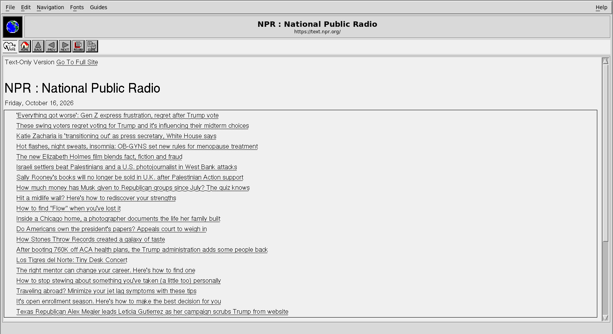
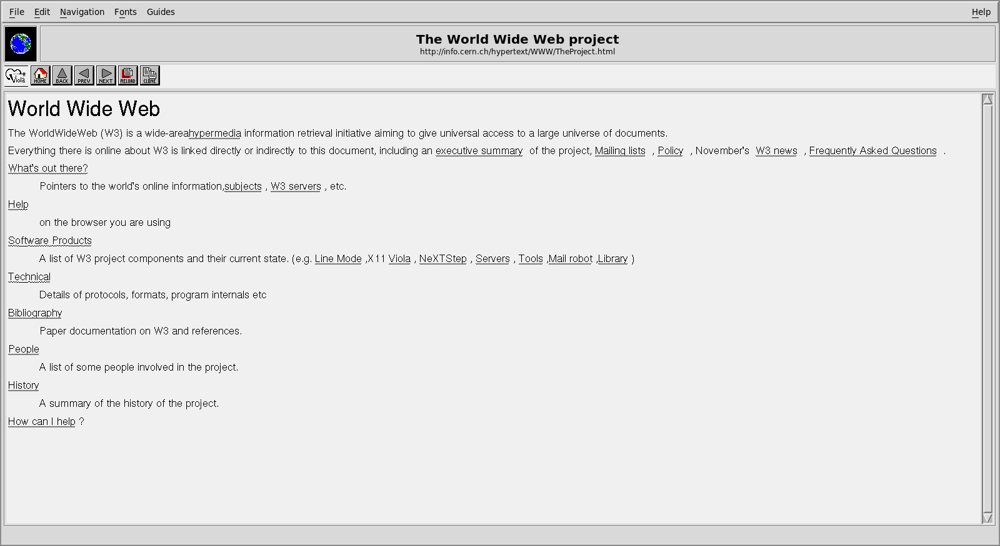

# ViolaWWW on Debian

A step-by-step guide to installing, building, running and troubleshooting
ViolaWWW on Debian Linux.

**Tested on:** Debian 13 "trixie", x86_64, GCC 14, with an X11 desktop.
Ubuntu and other Debian-based systems with the same packages should work.



---

## 1. Install the Packages

### Required

```bash
sudo apt install build-essential pkg-config byacc bsdextrautils \
    libmotif-dev libx11-dev libxext-dev libxt-dev libxmu-dev \
    libsm-dev libice-dev libxrender-dev \
    xfonts-75dpi xfonts-100dpi
```

| Package | Why |
|---------|-----|
| `build-essential`, `pkg-config` | Compiler, `make`, library detection |
| `byacc` | Generates the Viola script parser |
| `bsdextrautils` | Provides `hexdump`, used to compile the browser's built-in scripts |
| `libmotif-dev` | Motif toolkit for the `vw` browser |
| `libx11-dev` … `libxrender-dev` | X11 libraries |
| `xfonts-75dpi`, `xfonts-100dpi` | Bitmap Helvetica and Times fonts used for page text |

After installing the font packages for the first time, log out and back in
(or run `xset fp rehash`) so the X server sees them.

### Recommended

```bash
sudo apt install libssl-dev libicu-dev
```

- `libssl-dev` — HTTPS. Without it almost no modern site loads.
- `libicu-dev` — converts UTF-8 and other character sets into characters
  the browser can display.

### Optional

```bash
sudo apt install xdg-utils inetutils-telnet xterm opensp ghostscript imagemagick
```

| Package | Enables |
|---------|---------|
| `xdg-utils` | `mailto:` links open your mail program |
| `inetutils-telnet`, `xterm` | `telnet://` links open in a terminal window |
| `opensp` | HMML documents (the original Viola format) |
| `ghostscript`, `imagemagick` | PostScript documents and images |

See [EXTERNAL_DEPENDENCIES.md](EXTERNAL_DEPENDENCIES.md) for the full list.

---

## 2. Get the Source

```bash
git clone https://github.com/dleecurt/violawww.git
cd violawww
```

---

## 3. Build

```bash
make -j"$(nproc)"
```

This produces:

- `src/vw/vw` — the Motif browser (use this one)
- `src/viola/viola` — a plainer X11-only version
- `src/viola/sgmlsA2B` — HMML converter (only if `opensp` is installed)
- `vplot_dir/vplot` — 3D plotter

A few hundred compiler warnings are normal. If the build prints
"Building without OpenSSL" or "Building without ICU", install the
recommended packages and run `make clean && make`.

Optionally, run the unit tests (after building):

```bash
make test
```

All 21 should pass. For what each build stage does, see
[BUILD_PROCESS.md](BUILD_PROCESS.md).

### Updating

```bash
git pull
make clean && make -j"$(nproc)"
```

A clean rebuild after updating avoids stale built-in scripts and identifier
tables.

---

## 4. Run

```bash
./src/vw/vw                          # opens the home page
./src/vw/vw https://text.npr.org/    # opens a specific page
```

Run it from the source directory: it finds its application files
(`VIOLA_PATH`) automatically relative to the program. To change the home
page:

```bash
export WWW_HOME=https://wiby.me/
./src/vw/vw
```

### Using the browser

- **Navigation** — the toolbar buttons (Home, Back, Prev, Next, Reload,
  Clone) and the **Navigation** menu. **File → Open URL** (Ctrl-U) goes to
  an address.
- **Copy and paste** — **Edit → Copy** (Ctrl-C) copies selected page text
  to the clipboard; **Edit → Paste** (Ctrl-V) pastes into the page's text
  field you last clicked. Ctrl-C/X/V also work in dialog text fields.
- **Clone** (Ctrl-N) opens the current page in a second window.
- **Text size** — the **Fonts** menu switches between small, medium
  (default) and large Helvetica or Times.

### Sites that work well

ViolaWWW renders 1990s-era HTML: no JavaScript and very little CSS. Text-first
sites work well:

| Site | Notes |
|------|-------|
| `http://info.cern.ch/` | The first website |
| `https://text.npr.org/` | NPR news, text only |
| `https://lite.cnn.com/` | CNN, text only (a large page; takes a moment to lay out) |
| `https://wiby.me/` | Search engine for simple, classic-style sites |
| `https://lite.duckduckgo.com/lite` | DuckDuckGo search, lightweight version |
| `https://sdf.org/` | SDF Public Access UNIX System |



---

## 5. Customize

The browser reads X resources from `~/.Xresources` (class `Viola`). After
editing, load them with `xrdb -merge ~/.Xresources` and restart the browser.

### Window and page colors

```xdefaults
Viola*background:          gray85
Viola.background_doc:      white
```

`Viola*background` sets both the window frame and the page area (default
`gray94`).

### Fonts in menus, buttons and dialogs

These use smooth (Xft) fonts:

```xdefaults
Viola*uiFont.fontName:     DejaVu Sans
Viola*uiFont.fontSize:     11
Viola*titleFont.fontSize:  16
Viola*monoFont.fontName:   DejaVu Sans Mono
```

Available names: `uiFont` (most text), `boldFont`, `largeFont`, `monoFont`
(multi-line text fields), `titleFont`, `subTitleFont` and `urlFont` (the
title bar). Run `fc-list : family` to see installed font families.

### Window size and position

```xdefaults
Viola.width:   1000
Viola.height:  800
```

---

## 6. Troubleshooting

| Symptom | Cause and fix |
|---------|---------------|
| Page text looks blocky or every font is the same | The bitmap fonts aren't installed or loaded: install `xfonts-75dpi xfonts-100dpi`, then log out and in, or run `xset fp rehash`. |
| Warnings mentioning `FONT_IS_XFT` at startup; menus use plain fonts | Your Motif library was built without Xft support. Debian's is built with it; on other systems the browser still works, with plain fonts. |
| `Building without OpenSSL` during build; `https://` pages don't load | `sudo apt install libssl-dev`, then `make clean && make`. |
| A page loads from `web.archive.org` instead of the real site | The live site refused the request or failed, and the browser fell back to the Internet Archive's newest copy. Wikipedia does this always: it blocks ViolaWWW with HTTP 403 under its bot policy. |
| Page is blank or mostly empty | The site builds its pages with JavaScript, which ViolaWWW does not run. Try a text version of the site (see the table above). |
| Parts of a long page are blank after scrolling | Scroll a little further or reload; report it with a `-verbose` log if it keeps happening. |
| Clicking a `mailto:` link does nothing | Install `xdg-utils`; the status line names the missing program. |
| Clicking a `telnet:` link does nothing | Install `inetutils-telnet` and `xterm`. |
| Sounds on pages don't play | Audio playback is not supported on Linux yet (see Known limitations). |
| "Can't find object associated with window" in `-verbose` output | Normal: events for the Motif parts of the window. Filter with `grep -v "Can't find object"`. |
| A leak report is printed when quitting a `make san` build | LeakSanitizer reporting memory still in use at exit, not a crash. Run with `ASAN_OPTIONS=detect_leaks=0`. |
| `Can't find application files. Check VIOLA_PATH.` | Run `./src/vw/vw` from the source directory, or set `VIOLA_PATH` to `src/viola` in the source tree. |

---

## 7. Debugging

### Logs

```bash
./src/vw/vw -verbose 2>&1 | tee vw.log
```

`-verbose` traces network requests and responses, page parsing and window
events. For timing problems (slow pages, delayed drawing), add timestamps:

```bash
./src/vw/vw -verbose 2>&1 | grep --line-buffered -v "Can't find object" \
    | perl -MTime::HiRes=time -ne '$|=1; printf "%.3f %s", time, $_' > vw.log
```

Use `--line-buffered` with `grep`: without it, grep releases output in
chunks and the timestamps become meaningless.

### Sanitizer build

```bash
make san
ASAN_OPTIONS=halt_on_error=1:detect_leaks=0 ./src/vw/vw 2>&1 | tee asan.log
```

AddressSanitizer stops at the first memory error and prints where it
happened. Return to a normal build with `make clean && make`.

### Core dumps and gdb

```bash
sudo apt install gdb
gdb --args ./src/vw/vw https://example.com/
(gdb) run
# after a crash:
(gdb) bt
```

---

## 8. Known Limitations on Linux

- **JavaScript and modern CSS** are not supported; most modern sites render
  empty or partially.
- **Wikipedia** and some other sites block ViolaWWW (HTTP 403); the Internet
  Archive fallback is used instead.
- **Audio files** don't play: the player is hard-coded to macOS's `afplay`.
- **Page loading blocks input**: menus and the title bar keep repainting,
  but clicks and keys wait until the page has loaded, so a slow load can't
  be cancelled.
- **`rlogin://` links** need an `rlogin` client, which Debian no longer
  ships.
- **`make install`** is not tested on Linux; run the browser from the
  source directory.

---

## See Also

- [BUILD_PROCESS.md](BUILD_PROCESS.md) — How the build works
- [EXTERNAL_DEPENDENCIES.md](EXTERNAL_DEPENDENCIES.md) — External programs and environment variables
- [Main README](../README.md)
